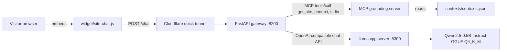

# site-chat-backend

A live AI chat panel for Jesun's portfolio project pages, running
entirely on our own stack: a FastAPI gateway, an MCP grounding server
built in the pattern of his own mcp-toolkit, and a small open-weight
model served by llama.cpp, all on one personal fleet server
(BlackBoxV3). A visitor on any of the 11 project dashboards can ask
questions about that project, and the assistant answers from the
project's own committed results, or says plainly that it does not
know.

**Honest model label.** The model is Qwen2.5-0.5B-Instruct
(GGUF Q4_K_M, SHA-256
74a4da8c9fdbcd15bd1f6d01d621410d31c6fc00986f5eb687824e7b93d7a9db),
a small open-weight base model served by llama.cpp (build b12418) on
our own fleet hardware. It is not a model trained from scratch, and
it is not fine-tuned yet. A fine-tune on the project corpus is
planned v2 (see below). The gateway's `/info` endpoint states the
same label.

## Architecture



Everything to the right of the tunnel runs on BlackBoxV3 in user
space: no Docker, no sudo, no cloud account, no API keys anywhere.

### Why the grounding is genuinely MCP

The gateway holds no project context. On every `/chat` request it
calls the MCP grounding server's `get_site_context` tool and builds
the prompt from what comes back. The gateway log records one line per
request (`mcp_context site=<slug> chars=<n>`). If the MCP server is
down, the gateway returns its busy message and answers nothing; the
test suite proves this with a gateway pointed at a missing MCP
server. The MCP server (`mcp_server/server.py`) is standard library
only, speaks MCP over stdio with protocol negotiation (2025-11-25
down to 2024-11-05), enforces the initialize lifecycle, and exposes
each site's context both as a resource (`sitechat://context/<slug>`)
and through the tool. Contexts live in `contexts/contexts.json`,
copied exactly from each repo's committed README and RESULTS files;
no figure is paraphrased and none is invented.

Transport choice: stdio, because the gateway and the grounding
server run on the same host in the same user space. Stdio needs no
extra port and no network surface to secure, and it matches the
stdio level of the mcp-toolkit this server is patterned on. HTTP
transport would add a second service to protect for no benefit on
one host.

### Honesty layers in the gateway

The model is small (0.5B), so three rules are enforced in the
gateway, openly, rather than left to the model's discretion:

- **Off-topic gate.** If a question shares no content word with the
  site's MCP-fetched context (and is not a support, hiring, or meta
  question), the gateway declines directly: "I do not know. That is
  not covered in this project's published results." An early live
  test showed why: asked for a chocolate cake recipe, the bare model
  happily wrote one out. With the gate, it declines.
- **Support block.** Questions about supporting or hiring are
  answered with the fixed link block (Sponsor, Buy Me a Coffee,
  Work with me), because the small model dropped the links when
  they were only in its prompt.
- **Simulated label guard.** If the fetched context marks its
  results SIMULATED, and the model's answer drops that word, the
  gateway prefixes the label. The label is part of the result.

## API

`POST /chat`

```json
{ "site": "cpp-ann-index-lab", "message": "What recall did IVF reach?", "history": [] }
```

- `site`: one of the 11 slugs in `contexts/contexts.json`.
- `message`: max 1000 characters.
- `history`: optional, max 6 turns, each max 1000 characters.
- Response: `{ "reply": "..." }`, or an error JSON with status 400
  (bad input or unknown site), 415 (not JSON), 429 (rate limited),
  or 503 (MCP server or model down; the body is one friendly busy
  message).
- CORS: only `https://jesunahmadushno.github.io` and
  `https://jesunahmadushno.com` receive CORS headers.
- Rate limit: 20 requests per 10 minutes per IP, best-effort, held
  in gateway memory.
- Message contents are never logged.

`GET /health` reports the gateway, MCP server, and model server
state plus the honest model label. `GET /info` describes the stack.

## Embed the widget

```html
<script defer src="https://jesunahmadushno.github.io/site-chat-backend/widget/site-chat.js"
  data-endpoint="https://creations-gary-rules-richmond.trycloudflare.com/chat"
  data-site="rag-eval-harness"></script>
```

The widget is dependency-free vanilla JS. It builds its DOM itself,
never blocks page rendering, and themes through CSS variables
(`--scb-bg`, `--scb-fg`, `--scb-accent`, `--scb-accent-fg`,
`--scb-border`, `--scb-radius`, `--scb-font`) so each site can match
its own design tokens.

## Limits, stated plainly

- **Temporary public address.** The gateway is reached through a
  Cloudflare quick tunnel. The URL changes whenever the tunnel
  restarts, and it dies with the host. The current URL is written on
  the host at `~/site-chat-logs/tunnel-url.txt`. A named tunnel on a
  stable subdomain needs a Cloudflare token with zone permission,
  which the available token does not have.
- **No auto-start.** After a reboot of BlackBoxV3, run
  `bash ~/site-chat-start.sh` by hand. It starts the model server,
  the gateway, and the tunnel, in that order, and prints the tunnel
  URL.
- **CPU speed.** The model runs on the host's CPU (Intel i5-8400).
  Short grounded answers take a few seconds. Long or compound
  questions are slower, and the small model can pair figures loosely
  on compound questions (observed once during verification: correct
  figures, wrong configuration label). Single-fact questions answer
  exactly.
- **One host.** If BlackBoxV3 is off, the chat is off. The widget
  shows a plain fallback message in that case.
- **Earlier route, dropped.** This backend was first designed as a
  Cloudflare Worker on Workers AI. Jesun ordered the own-stack route
  instead, and the Worker was never deployed (the available
  Cloudflare token also lacks Workers Scripts Edit permission; its
  upload returned 403). No Worker is running.

## Verification (2026-11-15, live on BlackBoxV3)

Test suite: `python3 -m pytest test/ -q`, 7 passed, both on the
build VM and on BlackBoxV3. The suite runs the real MCP server and
the real gateway against a fake model server and proves: a figure
that exists only in a site's context (recall@10 0.9487) reaches the
model through MCP; an off-topic question declines without calling
the model; a gateway with a dead MCP path returns 503; the MCP
server rejects calls before initialize, lists 11 resources, and
renders contexts through tools/call.

Live checks against the running stack (gateway log shows one
`mcp_context` line per chat request):

- Health: `{"ok": true, "mcp_server": "up", "model_server": "up"}`,
  with the honest model label.
- Grounded, cpp-ann-index-lab: "What recall did the IVF index
  reach, and how fast was it?" Answer: "The IVF index reached a
  recall of 0.9487 with a p99 of 1.281 ms, which is 8.42x faster
  than brute force." Exact.
- Grounded, multi-doc-research-assistant: "How often does the tool
  refuse questions that are not in the documents?" Answer carries
  the measured figure 0.900 (18 of 20 in the context).
- Grounded, hitl-approval-gate: "What was the routing accuracy in
  the study?" Answer: "This was a simulated study, run with a
  scripted approver, not a person. 1.000 (240 of 240,
  independently recomputed)". Label and figure both correct.
- Out of context, fde-backend-service: "What is a good recipe for
  chocolate cake?" Answer: the plain decline.
- Support question, mcp-toolkit: answered with the fixed block
  carrying all three links (Sponsor, Buy Me a Coffee, Work with me).
- Oversized message (1100 characters): HTTP 400.
- Disallowed origin (`https://evil.example.com`): no CORS headers.
  Allowed origin through the tunnel: CORS header present.
- Through the public tunnel, from the host network: `/health` ok,
  and the cpp-ann-index-lab round trip above returned the same
  exact answer. (The build sandbox VM's own egress is blocked by
  Cloudflare, as with the fleet's other quick tunnel, so public
  checks run from the host network.)

## Run it

On BlackBoxV3 the stack is already deployed at `~/site-chat-backend`
with its start script at `~/site-chat-start.sh`. From a fresh clone:

```bash
python3 -m venv .venv
.venv/bin/pip install -r requirements.txt
# model server (llama.cpp b12418, model file as above)
llama-server -m qwen2.5-0.5b-instruct-q4_k_m.gguf --host 127.0.0.1 --port 8300 -c 4096
# gateway (spawns the MCP grounding server itself)
LLAMA_URL=http://127.0.0.1:8300 .venv/bin/uvicorn app.gateway:app --host 127.0.0.1 --port 8200
# optional public reach
cloudflared tunnel --url http://127.0.0.1:8200 --no-autoupdate
```

`scripts/start_on_v3.sh` is the exact script the host runs.

## v2 plan (future work, not claimed now)

- Fine-tune the model on the project corpus (the READMEs, RESULTS
  files, and study reports), served the same way, and re-run this
  verification record against it.
- A named Cloudflare tunnel on a stable subdomain, once a token
  with zone permission exists.
- Auto-start on host boot.

## License

Apache-2.0.
